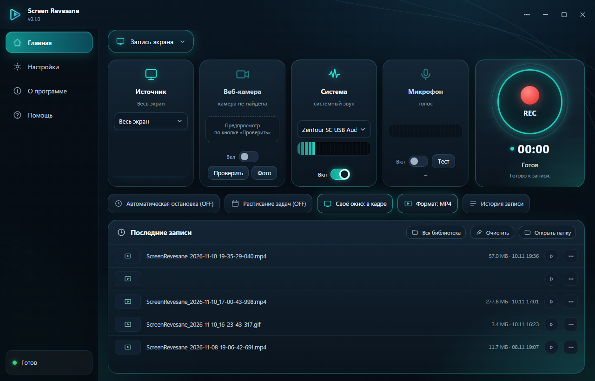
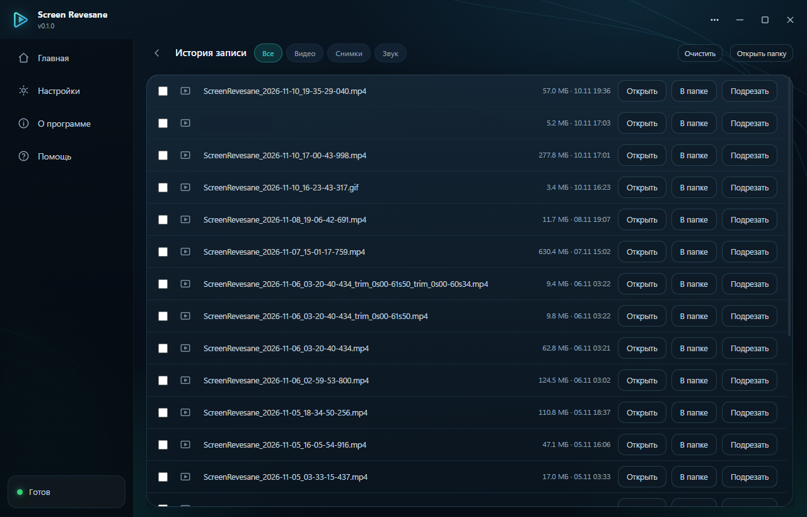
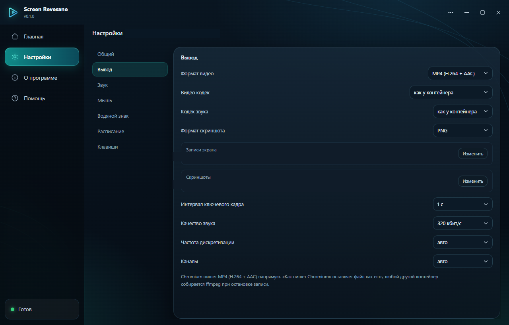

# Screen Revesane

Свой рекордер экрана на Electron: весь экран, отдельное окно или выделенная область — с микрофоном, системным звуком и без облачных сервисов. Всё остаётся на вашем диске.

<p align="center">
  
</p>

<p align="center">
  
</p>

<p align="center">
  
</p>

## Скачать

Готовые установщики последней версии — в [релизах](https://github.com/Revesane/screen-revesane/releases/latest):

| Файл | Система |
| --- | --- |
| `Screen-Revesane-Setup-<версия>.exe` | Windows 10/11 — установщик (ярлыки, деинсталлятор) |
| `Screen-Revesane-<версия>-mac.dmg` | macOS 10.15+ — Intel и Apple Silicon |
| `Screen-Revesane-<версия>-mac.zip` | macOS — portable: распаковать и перетащить в «Программы» |

Сборки не подписаны сертификатом: Windows покажет SmartScreen («Подробнее → Выполнить в любом случае»), macOS при первом запуске — правый клик → «Открыть».

## Возможности

- **Три режима записи** — весь экран, окно приложения или область, выделенная мышью (рамку можно двигать и тянуть за края перед подтверждением).
- **Скриншоты** — экран, окно, область («как в Ножницах»: выделил → разметил → скопировал/сохранил). Разметка: стрелка, прямоугольник, текст, замазка, копирование в буфер.
- **Звук** — микрофон и системный звук по отдельности, с балансом и живыми индикаторами уровня; для окна системный звук берётся второй сессией захвата; источник звука компьютера можно выбрать входом (DAW на ASIO не теряется).
- **Форматы** — MP4/MKV/MOV/WMV/WebM/GIF/F4V/MPEG-TS, выбор видео- и аудиокодека (H.264, HEVC, ProRes, VP9…), «как у Chromium» без перекода. Если [ffmpeg](https://ffmpeg.org) в `PATH` нет, приложение скачает его само при первом запуске (в `%APPDATA%\Screen Revesane\tools`); свой ffmpeg в PATH приоритетнее.
- **Запись «только звук»** — MP3/M4A/WMA/AAC/Opus/FLAC/WAV.
- **Редактор** — обрезка по таймлайну, кадр в PNG, смена скорости, склейка выбранных записей, панорама из снимков.
- **Водяной знак** — текст или PNG поверх кадра, позиция/размер/прозрачность.
- **Расписание и авто-стоп** — запись по таймеру «через N минут» или «в точное время», автоматическая остановка по длительности.
- **Компактный режим** — окно 470×306 поверх остальных; плавающая панель записи и рамка вокруг области (не попадают в кадр).
- **Скрытие своего окна** — приложение исключается из захвата одним переключателем.
- **Горячие клавиши** — назначаемые, с проверкой конфликтов; подсветка курсора в кадре.
- **Русский и английский интерфейс** — по языку системы или вручную (Настройки → Общий → «Язык интерфейса»), переключается на лету.

## Запуск из исходников

Нужен [Node.js](https://nodejs.org) (LTS). Приложение использует Electron из `devDependencies`:

```bash
npm install
npm start
```

[ffmpeg](https://ffmpeg.org/download.html) и `ffprobe` ставить заранее не обязательно: если их нет в `PATH`, при первом запуске приложение скачает сборку автоматически (GitHub-сборки BtbN, запасной источник — gyan.dev) и продолжит работу, как только загрузка закончится. Скачанную копию можно удалить папкой `%APPDATA%\Screen Revesane\tools`.

## Сборка установщиков

Windows — NSIS-установщик (ярлыки, деинсталлятор, выбор папки), macOS — DMG и zip (universal: Intel + Apple Silicon):

```bash
npm run dist       # Windows: dist/Screen-Revesane-Setup-<версия>.exe
npm run dist:mac   # macOS:   dist/Screen-Revesane-<версия>-mac.dmg (собирать на Mac)
```

Сборки не подписаны сертификатом — Windows покажет предупреждение SmartScreen («Подробнее → Выполнить в любом случае»), macOS потребует правый клик → «Открыть» при первом запуске. Пуш тега `v*` запускает GitHub Actions: NSIS-установщик Windows и universal DMG/ZIP для macOS собираются автоматически и прикрепляются к релизу.

## macOS: особенности

- **Системный звук** — macOS не отдаёт звук системы напрямую, как Windows: поставьте бесплатный виртуальный драйвер [BlackHole](https://existential.audio/blackhole/), затем в настройках Screen Revesane выберите его **источником звука компьютера**. Микрофон и запись звука «только звук» работают без этого.
- **ffmpeg** — если в PATH его нет, приложение скачает статические сборки автоматически при первом запуске (в `~/Library/Application Support/Screen Revesane/tools`). ffmpeg, установленный через brew, найдётся даже при запуске из Finder.
- **Горячие клавиши** — назначаются в «Настройки → Клавиши»; macOS может требовать разрешения «Мониторинг ввода» для глобальных клавиш.

## Горячие клавиши (по умолчанию)

| Клавиша | Действие |
| --- | --- |
| `F9` | Старт / стоп записи |
| `F8` | Пауза / продолжить |
| `F7` | Выделить область и записать её видео |
| `F6` | Снимок области (сразу открывается в редакторе разметки) |
| `F10` | Скриншот выбранного источника |

Остальные действия (стоп, библиотека, микрофон, панель) назначаются в «Настройки → Клавиши» — глобальная клавиша отнимается у всей системы, поэтому за вами выбор.

## Как это устроено

```
src/
├── main/        # Главный процесс: окна, IPC, ffmpeg-конвейер, настройки, логи
│   ├── main.js        # Жизненный цикл, запись, конвертация, библиотека
│   ├── watermark.js   # План наложения водяного знака для фильтров ffmpeg
│   └── log.js         # Файловый лог с ротацией на 7 дней
├── recorder/    # getDisplayMedia → canvas-композиция → MediaRecorder → чанки в main
├── renderer/    # Интерфейс (ванильный JS, без фреймворков и сборки)
├── region/      # Оверлей выделения области (рамка, перенос, края)
├── frame/       # Рамка вокруг записываемой области (исключена из захвата)
└── panel/       # Плавающая панель записи
```

- Запись идёт в `MediaRecorder`, чанки стримятся в главный процесс и пишутся в файл `<имя>.part.<ext>`; после остановки перекодируется/ремуксится в выбранный контейнер. Недописанные `.part`-файлы после падения чинятся при следующем запуске.
- Первые секунды записи закрываются заглушкой-снимком, пока Windows Graphics Capture не отдаст первый кадр.
- Настройки — `%APPDATA%\Screen Revesane\settings.json`, логи — там же в `logs\`.

## Самопроверка

В коде есть встроенные прогоны, которыми проверяется всё ядро (запись всех режимов, звук в записи окна, перекоды, расписание, водяной знак, склейка):

```bash
npm start -- --selftest        # полный прогон с записью
npm start -- --selftest-modes  # режимы захвата с тестовым окном
npm start -- --ui-shots        # снимки интерфейса в %TEMP%
```

## Лицензия

[MIT](LICENSE)
